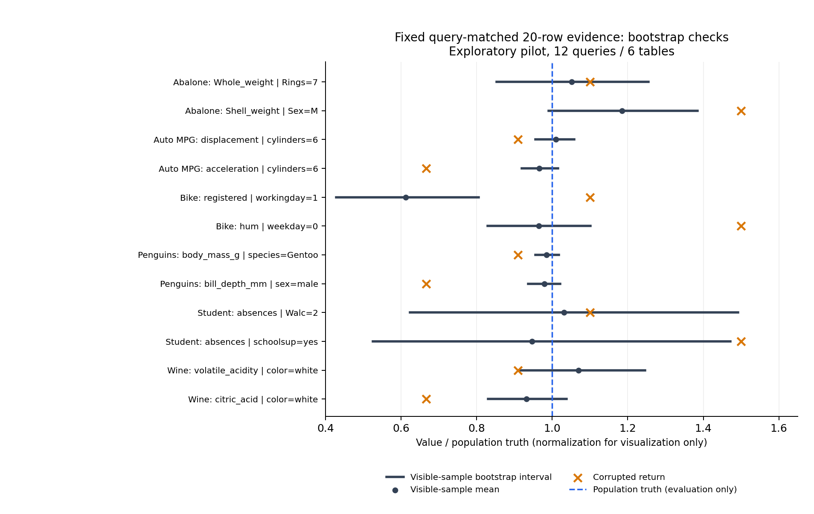

# 相同样本的统计核验实验（2026-11-07）

## 这轮回答了什么

在本轮十二个预选查询的相关二十行条件中，已有 bootstrap 核验器能提取出明显判别信号，而提示式模型审计仍接受较多错误返回。因而，单纯“展示的数据太少”不足以概括这些模型失败；证据提取、表示和使用过程值得进一步干预检验。

这不是新算法；也没有证明某个内部机制或统计方法普遍优于 LLM。数值证据相同，但统计程序拿到明确的结构化查询规格，并执行了 bootstrap 运算；两者的输入表示、计算过程和成本不相同。

## 主要结果：相同的相关 20 行

| 核验方式 | 保留正确返回 | 接受/兼容错误返回 | 明确标错/拒绝错误 | 不确定错误 | 正确 / 错误格式失败 |
|---|---:|---:|---:|---:|---|
| bootstrap 0d | 11/12 | 2/12 | 10/12 | 0 | 0 / 0 |
| gemini-3.8-flash | 11/12 | 5/12 | 5/12 | 0 | 1 / 2 |
| qwen3-8b | 12/12 | 11/12 | 0/12 | 1 | 0 / 0 |

0d 通过极端污染 sanity（AUROC=1.000）。真实污染的表内 AUROC=0.917，六表描述性 bootstrap 区间 [0.833, 1.000]；pooled=0.882，仅作次要结果。

固定规则下，0d 标出错误 10/12，同时误标正确 1/12。“兼容”只表示没有与样本统计冲突，不能当成“已经确认正确”。模型不接受可能是拒绝、犹豫或格式失败，应分别看。

## 所有条件，包括失败的条件

| 方法 | Context | 有分数的查询 / 12 | Sanity AUROC | 正确值被标错 | 错值被标错 | 真实污染表内 AUROC |
|---|---|---:|---:|---:|---:|---|
| 0a | head5 | 5/12 | 0.792 | 5/12 | 4/12 | withheld |
| 0a | random20 | 12/12 | 0.885 | 3/12 | 7/12 | withheld |
| 0a | matched20 | 12/12 | 0.958 | 0/12 | 2/12 | 0.583 |
| 0d | head5 | 3/12 | 0.875 | 3/12 | 2/12 | withheld |
| 0d | random20 | 11/12 | 0.938 | 3/12 | 7/12 | withheld |
| 0d | matched20 | 12/12 | 1.000 | 1/12 | 10/12 | 0.917 |

未通过 sanity 的行仅是失败诊断；对应真实 AUROC 和跨 context 效应按协议 withheld。不能用这张表宣称已量化“相关 20 行比随机 20 行更好”。head5 经常没有筛选后的有效样本；缺失没有填成正常分数。

## 严重度和逐查询例外

| 0d matched20 严重度 | 错值被标错 | 正确值被误标 | 表内 AUROC |
|---|---:|---:|---:|
| plausible | 6/6 | 0/6 | 1.000 |
| subtle | 4/6 | 1/6 | 0.833 |

严重度与查询身份绑定，不能把切片差异解释成严重度的因果效果。

| 查询 | 样本均值 | 样本 bootstrap 区间 | 正确值判定 | 错误值判定 |
|---|---:|---|---|---|
| lt_abalone_fil_016 | 0.41808 | [0.33901, 0.49875] | compatible | compatible |
| lt_abalone_fil_018 | 0.33422 | [0.27935, 0.39055] | compatible | flag |
| lt_auto_mpg_v4_fil_013 | 220.15 | [208.45, 230.8] | compatible | flag |
| lt_auto_mpg_v4_fil_014 | 15.71 | [14.96, 16.51] | compatible | flag |
| lt_bike_v4_fil_011 | 102.6 | [71.843, 134.95] | flag | flag |
| lt_bike_v4_fil_012 | 0.606 | [0.5205, 0.69152] | compatible | flag |
| lt_penguins_v3_fil_013 | 5000 | [4852.5, 5166.3] | compatible | flag |
| lt_penguins_v3_fil_014 | 17.52 | [16.75, 18.275] | compatible | flag |
| lt_student_fil_012 | 3.8 | [2.3, 5.5] | compatible | compatible |
| lt_student_fil_018 | 2.7 | [1.4975, 4.2] | compatible | flag |
| lt_wine_quality_fil_012 | 0.2975 | [0.25325, 0.34651] | compatible | flag |
| lt_wine_quality_fil_014 | 0.3115 | [0.27749, 0.347] | compatible | flag |

唯一 clean false flag 是 Bike 的 registered / workingday=1；两个未标出的错误是 Abalone Whole_weight 与 Student absences 的 subtle 查询。该例外说明固定样本可能偏离总体，也说明 bootstrap 区间没有自动的 95% 总体覆盖保证。

距离边界最近的已标错返回是 lt_wine_quality_fil_012，仅在区间外 0.000304（原始单位）。当前没有调整阈值；后续独立抽样重复尤其需要检查这种边界判断的稳定性。



图中数值除以总体真均值，仅为跨量纲绘图。总体真值只用于评价和这条参考线，从未作为核验器特征。每行展示一份冻结样本，不是跨抽样平均。

## 与模型的描述性配对差值

指标为“兼容正确 − 兼容错误”减去模型“接受正确 − 接受错误”；不是 AUROC 差值。

| 模型对照 | 格式处理 | 查询 / 表 | 差值（百分点） | 描述性区间（百分点） |
|---|---|---|---:|---|
| gemini-3.8-flash | all_model_formats | 12 / 6 | +25.0 | [+8.3, +41.7] |
| gemini-3.8-flash | valid_model_pairs | 9 / 5 | +20.0 | [+0.0, +40.0] |
| qwen3-8b | all_model_formats | 12 / 6 | +66.7 | [+50.0, +83.3] |
| qwen3-8b | valid_model_pairs | 12 / 6 | +66.7 | [+50.0, +83.3] |

Gemini 完整有效配对仅九查询、五表，且存在公开数据集先验；Qwen 的原始 responses 尚未入库。该差值不能证明通用模型优劣，也不能定位差距来自提示、算术、表征还是其他内部过程。

## 论文结论现在怎么写

可写：在选定的数值工具返回任务中，核验表现同时取决于展示的证据和采用的核验程序；直接多展示相关行尚未带来跨模型稳定收益，但相同相关样本中的统计信号能被已有核验器提取。这个结果支持继续研究如何把可核验的证据接入工具返回审计。

不可写：所有不确定性方法都没用、模型完全不会利用证据、更多 context 无效、0d 总能识错、0o* 是通用信息论上界、或者已提出一个优于现有方法的新算法。

## 投稿判断与下一步

有继续组织成实证 workshop 短文的价值，但不能给可靠录用概率。目标 workshop 明确接受负结果与四页短文，同时强调系统机制、审计和可信演化；本项目可定位为运行时工具返回核验的实证研究。当前只测单次数值返回，没有验证长期状态演化，不能包装成已经解决可信演化。[官方征稿](https://trust4rsi-agent.github.io/AAAI2027/)

主要风险仍是六张表、复用的十二个 filtered-mean 查询、一次冻结抽样、两个模型族与既有方法。本轮协议先于新基线测量，但我们已知道任务和模型结果，因此不是独立确认集。

下一步先锁定独立抽样重复和新生成/变换表的规则，检查统计核验的误报是否稳定；随后在新表上让 Gemini/Qwen 对照“原始样本行”与“相同行生成的统计摘要”，保留 0d、clean、明显错误 sanity 和弃答计数。摘要不能混入全表真值，只能加工已经展示的样本。这样检验的是可干预的证据表达，而非仅重复比较模型数量。

本轮按固定协议到此完成，没有依据效果扩大样本或新调用 API。下一轮需要单独预注册；不能拿扩大后的结果替换这份 pilot。

## 实现与审查

- 协议 `f94ffbb`；代码 `a5b6e07`；36 个 query/context，288 个 real/sanity/method 事件。
- 0a、0d、区间打分直接复用 zeroparam.py；bootstrap B=2000，按 query/context 独立固定 seed。
- 九项合成数据测试通过；共享 P4 helpers 的三组检查 ALL PASS。
- 独立 reviewer 用保存区间/范围复算全部 score，并用两类分数排序复算 AUROC；没有重跑 bootstrap，未发现新计算错误。
- 统计摘要和图可从 summary/features/events 重新生成；Python/依赖版本、源代码和模型评分文件哈希保存在 config.json。

```bash
python experiments/report_context_evidence.py
```

设计与审查使用 experimental-design / scientific-critical-thinking skills。方法资源：Kassis, T., Agarwal, V., He, Y., Patel, D., & Brueckner, A. M. (2026). *Scientific Agent Skills: A Library of Procedural Knowledge for Research Agents*. [arXiv:2609.00065](https://doi.org/10.48550/arXiv.2609.00065)。引用用于说明研究辅助工具，不为实验结论背书。


## 后续独立抽样阶段

随后按单独协议完成二十次独立抽样检查，见 [稳健性报告](CONTEXT_EVIDENCE_RESAMPLING_2026-11-07.md)。两阶段估计对象不同，本报告的原始结果继续保留。
